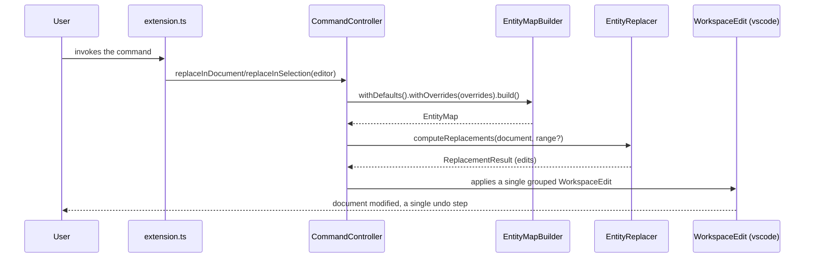

# Architecture

HTML Entity Swapper is structured in layers to isolate the business logic from the editor
API. The goal: a core that is testable without a VS Code host, portable (web), and a single
boundary with `vscode`.

## Layers

- Core (`core/`): pure logic. Never imports `vscode`. Contains the entity map, the map
  builder, the compute engine, and the value objects.
- Ports (`core/ports/`): interfaces describing what the core needs
  ([IConfigurationProvider](../src/core/ports/IConfigurationProvider.ts),
  [ITextDocument](../src/core/ports/ITextDocument.ts)).
- Adapters (`adapters/`): the only layer that imports `vscode`. Implements the ports and
  applies the edits.
- Entry point ([extension.ts](../src/extension.ts)): composition root that wires the
  dependencies and registers the commands.

## Layer diagram

## Command flow

## Patterns

- Builder (fluent interface):
  [EntityMapBuilder](../src/core/EntityMapBuilder.ts) assembles defaults and overrides
  into an immutable [EntityMap](../src/core/EntityMap.ts) with O(1) lookup, and returns `this`.
- Adapter: [VscodeConfigurationProvider](../src/adapters/VscodeConfigurationProvider.ts)
  and [VscodeDocumentAdapter](../src/adapters/VscodeDocumentAdapter.ts) connect the editor
  API to the core's ports.
- Dependency Inversion: the core depends on the ports, not on the concrete adapters.
- Immutable value objects: [Replacement](../src/core/models/Replacement.ts) and
  [ReplacementResult](../src/core/models/ReplacementResult.ts), with no mutation.

## Fixes relative to the reference extension

- A single grouped edit (`WorkspaceEdit`) instead of one edit per character: a single undo
  step and better performance.
- On-demand rebuild of the map, invalidated on configuration change: no window reload needed.
- Entity map deduplicated and corrected in
  [default-entities.ts](../src/data/default-entities.ts).
