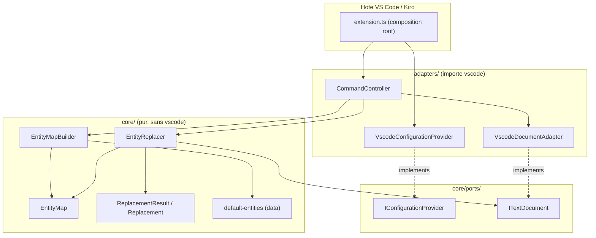
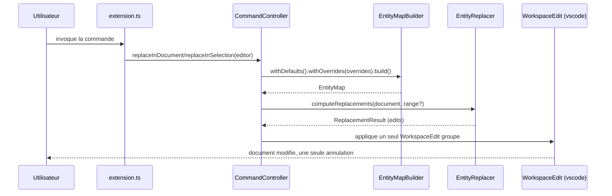

# Architecture

HTML Entity Swapper est structurée en couches pour isoler la logique métier de
l'API de l'éditeur. L'objectif : un cœur testable sans hôte VS Code, portable (web),
et une seule frontière avec `vscode`.

## Couches

- Cœur (`core/`) : logique pure. N'importe jamais `vscode`. Contient la table de
  correspondance, le constructeur de table, le moteur de calcul et les objets valeur.
- Ports (`core/ports/`) : interfaces décrivant ce dont le cœur a besoin
  ([IConfigurationProvider](../src/core/ports/IConfigurationProvider.ts),
  [ITextDocument](../src/core/ports/ITextDocument.ts)).
- Adaptateurs (`adapters/`) : seule couche qui importe `vscode`. Implémente les ports
  et applique les éditions.
- Point d'entrée ([extension.ts](../src/extension.ts)) : racine de composition qui
  câble les dépendances et enregistre les commandes.

## Diagramme des couches

## Flux d'une commande

## Patterns

- Builder (interface fluente) :
  [EntityMapBuilder](../src/core/EntityMapBuilder.ts) assemble défauts et surcharges
  en une [EntityMap](../src/core/EntityMap.ts) immuable à lookup O(1), et renvoie `this`.
- Adapter : [VscodeConfigurationProvider](../src/adapters/VscodeConfigurationProvider.ts)
  et [VscodeDocumentAdapter](../src/adapters/VscodeDocumentAdapter.ts) relient l'API de
  l'éditeur aux ports du cœur.
- Dependency Inversion : le cœur dépend des ports, pas des adaptateurs concrets.
- Value Objects immuables : [Replacement](../src/core/models/Replacement.ts) et
  [ReplacementResult](../src/core/models/ReplacementResult.ts), sans mutation.

## Corrections par rapport à l'extension de référence

- Une seule édition groupée (`WorkspaceEdit`) au lieu d'une édition par caractère :
  annulation unique et meilleures performances.
- Reconstruction de la table à la demande, invalidée sur changement de configuration :
  plus besoin de recharger la fenêtre.
- Table de correspondance dédoublonnée et corrigée dans
  [default-entities.ts](../src/data/default-entities.ts).
